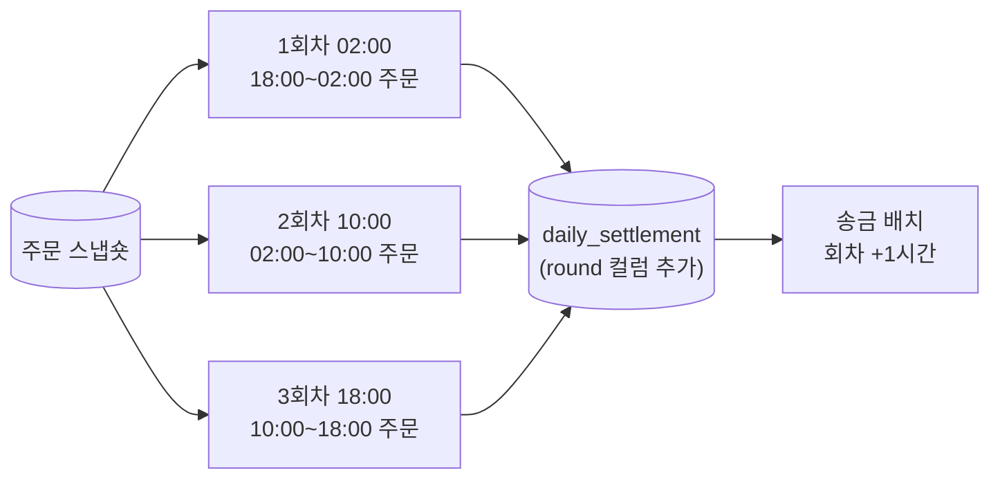

<!-- 독자: backend-dev(expert) + 팀 리드 — 정산 배치 구조를 아는 정산플랫폼팀과 결정에 참여하는 리드 / 어조: 합니다체 / 유형: 설계·ADR -->
<!-- 이 문서는 tech-writer 스킬의 본보기다. 소재(정산 배치, 사내 도구 이름, 수치)는 설명을 위해 만든 것이다. -->

# 정산 확정을 하루 3회차로 나눈다

<!-- ✓ Q-3: 상태, 날짜, 작성자, 결정자를 한 줄로 -->
상태: 승인 · 작성일: 2026-09-02 · 갱신일: 2026-10-15 · 작성: 정산플랫폼팀 · 결정: 정산플랫폼팀, 재무시스템팀 리드

## 요약

<!-- ✓ E-2: 결정, 핵심 이유, 감수하는 비용을 맨 앞에 -->
정산 배치를 하루 1회(02:00)에서 3회차(02:00, 10:00, 18:00)로 나눠, 가맹점 송금을 하루 3번 할 수 있게 합니다. 일 배치 구조를 그대로 두고 집계 범위만 회차 단위로 바꾸는 방식을 골랐습니다. 대신 회차 경계에 걸친 환불 처리 규칙이 하나 늘어납니다.

## 배경

<!-- ✓ F-2: 문제를 수치로 -->
재무시스템팀은 2027년 1분기부터 가맹점 송금을 하루 3회로 늘립니다(소상공인 자금 회전 개선 과제). 지금 정산은 하루 한 번 02:00에 시작해 약 9분 뒤 확정되고(마감 여유를 두고 02:30을 확정 시각으로 봅니다), 송금은 09:00 한 번입니다. 송금 횟수만 늘리면 2·3번째 송금 때 보낼 확정 금액이 없습니다.

현재 구조는 "정산 배치는 어떻게 동작하나" 문서에 있습니다. 그 문서의 대안 비교에서 "송금 주기가 하루 여러 번으로 바뀌면 다시 검토한다"고 남겼고, 이 문서가 그 재검토입니다.

## 목표와 비목표

<!-- ✓ S-2: 결정 기준을 목록으로 먼저 고정 -->
목표
- G1. 회차마다 그 회차까지의 결제 완료 주문이 정산 확정됩니다.
- G2. 회차 정산은 시작 후 30분 안에 끝납니다. 송금 배치가 회차 시작 1시간 뒤에 돌므로, 30분 안에 끝나면 장애 대응에 30분이 남습니다.
- G3. 기존 정산 재처리 API와 감사 로그가 그대로 동작합니다.
- G4. 정산플랫폼팀 3명이 2개월 안에 전환할 수 있어야 합니다.

비목표
- 실시간 정산(주문마다 즉시 확정)은 하지 않습니다.
- 송금 배치 변경은 재무시스템팀이 맡고 이 문서에서 다루지 않습니다.

## 대안 비교

세 가지 안을 목표(G1~G4)에 대어 비교했습니다.

<!-- ✓ L-4: 대안을 같은 기준으로 표에 -->
| 기준 | A. 회차 배치 (일 배치 확장) | B. 스트리밍 집계 | C. 일 배치 유지 + 선지급 |
|---|---|---|---|
| G1 회차별 확정 | 충족 | 충족 | 미충족(추정액 지급) |
| G2 30분 안에 완료 | 충족(일 배치 약 9분의 1/3, 회차당 약 3분) | 충족 | 해당 없음 |
| G3 재처리·감사 호환 | 충족(구조 동일) | 재설계 필요 | 충족 |
| G4 3명·2개월 | 충족(약 6주 추정) | 미충족(상태 저장소 신규 운영) | 충족 |
| 새로 생기는 규칙 | 회차 경계 환불 처리 | 지연 이벤트 처리 | 선지급 차액 정산 |

<!-- ✓ S-1: 탈락 이유를 한 줄씩 -->
- B는 G1·G2를 가장 잘 만족하지만, 상태 저장소를 새로 운영해야 해 G4를 넘습니다.
- C는 확정 전 금액을 보내므로 차액 정산과 회수 절차가 생기고, 재무 감사 기준에 맞지 않습니다.

## 결정

A안, 회차 배치를 택합니다. 정산 배치의 집계 범위를 "전날 하루"에서 "직전 회차 이후"로 바꾸고, 나머지 단계(계산, 저장, 마감)는 그대로 둡니다.

<!-- ✓ M-3: 그림 앞 안내 -->
다음 그림은 바뀐 뒤의 하루 흐름입니다.

<!-- ✓ M-3: 그림 뒤 핵심 -->
바뀌는 것은 집계 범위와 `round` 컬럼뿐이고, 송금 배치는 회차가 끝나고 1시간 뒤에 그 회차 결과만 읽습니다.

회차 경계에 걸친 환불은 다음 규칙으로 처리합니다.

<!-- ✓ C-5: expert 독자에게도 새로 생긴 규칙은 정의한다 -->
- 원주문이 이미 확정된 회차에 속하면, 환불은 환불이 결제된 회차의 차감 항목으로 넣습니다. 확정된 회차를 다시 열지 않습니다.

### 결정의 한계

<!-- ✓ P-1: 결정이 유효한 전제와 검증하지 않은 것을 스스로 적는다 -->
- 회차당 처리 시간(약 3분)은 9월 주문량으로 추정한 값입니다. 연말 성수기(평소의 2.4배) 기준으로는 아직 측정하지 않았습니다.
- 회차 경계 환불 규칙이 감사 검토에서 반려되면, 경계에 걸친 환불만 다음 날 1회차로 미루는 보수적 규칙으로 바꿉니다. 이 경우에도 회차 배치 구조는 그대로입니다.
- 송금이 하루 6회 이상으로 늘면 회차 배치의 고정 비용(회차당 기동 약 40초)이 커지므로 B안을 다시 검토해야 합니다.

## 영향과 리스크

| 대상 | 영향 | 리스크 | 완화 |
|---|---|---|---|
| 정산 DB | `daily_settlement`에 `round` 컬럼 추가 | 기존 조회 쿼리가 회차를 합산하지 않음 | 1차 배포에서 `round=1`만 쓰고 조회 뷰를 먼저 바꿈 |
| 재무시스템팀 송금 배치 | 회차 단위로 읽도록 변경 | 두 팀 배포 순서가 어긋나면 송금 누락 | 정산이 먼저 배포하고, 송금은 `round` 지원 확인 후 배포 |
| 정산 배치 운영 | 장애 대응 시간대가 하루 3번 | 야간·주간 담당 공백 | 회차별 담당을 런북에 명시 |

## 후속 작업

<!-- ✓ S-1: 결정을 다시 볼 조건을 남긴다 -->
| 할 일 | 담당 | 기한 |
|---|---|---|
| `round` 컬럼과 조회 뷰 배포 | 정산플랫폼팀 | 2026-10-31 |
| 성수기 주문량으로 회차 처리 시간 측정 | 정산플랫폼팀 | 2026-11-15 |
| 회차 경계 환불 규칙 감사팀 검토 | 재무시스템팀 | 2026-11-15 |
| 런북에 회차별 담당 추가 | 정산플랫폼팀 | 2026-12-01 |
| 송금 배치를 회차 단위로 변경해 배포 | 재무시스템팀 | 2026-12-15 |
| 두 팀 통합 리허설(스테이징, 3회차 하루치) | 정산플랫폼팀, 재무시스템팀 | 2026-12-22 |

재검토 조건: 송금 주기가 하루 6회 이상이 되거나, 회차 처리 시간이 20분을 넘으면 이 결정을 다시 봅니다.
