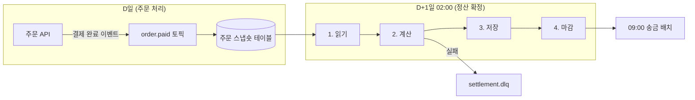

<!-- 독자: backend-dev(intermediate) — 정산플랫폼팀에 합류한 개발자, Spring Batch와 Kafka 기본은 앎 / 어조: 합니다체 / 유형: 설명 -->
<!-- 이 문서는 tech-writer 스킬의 본보기다. 소재(정산 배치, 사내 도구 이름, 수치)는 설명을 위해 만든 것이다. -->

# 정산 배치는 어떻게 동작하나

<!-- ✓ E-1: 한 줄 정의와 읽고 나면 이해하게 되는 것 -->
정산 배치는 매일 새벽 전날 결제 완료 주문을 가맹점별로 집계해 송금할 금액을 확정하는 작업입니다. 이 문서를 읽으면 주문 한 건이 정산 금액이 되기까지 거치는 단계와, 각 단계가 그렇게 설계된 이유를 이해할 수 있습니다.

## 한 줄 정의

<!-- ✓ C-4: intermediate 독자 기준으로 비유 없이 정의 -->
정산 배치는 "어제 확정된 주문"을 입력으로, "가맹점별 송금액"을 출력으로 하는 하루 한 번의 집계 작업입니다.

## 등장 배경

<!-- ✓ S-3: 원리보다 풀려는 문제를 먼저 -->
정산 배치가 생기기 전에는 주문 API가 결제 완료 시점마다 정산 테이블을 바로 갱신했습니다. 이 방식에는 두 가지 문제가 있었습니다.

1. 결제 취소·부분 환불이 같은 날 들어오면 정산 금액이 여러 번 바뀌었고, 송금 시점의 금액을 재현할 수 없었습니다.
2. 주문이 몰리는 시간대(20:00~22:00)에 정산 테이블 잠금 때문에 주문 API 응답이 평소의 3배(p95 1.2초)까지 늘었습니다.

그래서 "주문 처리"와 "정산 확정"을 분리하고, 정산은 하루가 끝난 뒤 한 번에 확정하기로 했습니다.

## 동작 원리

<!-- ✓ E-4: 단계순 전개 + 단계마다 같은 틀(무엇을 / 왜) -->
정산 배치는 매일 02:00에 시작해 네 단계를 거칩니다.

<!-- ✓ M-3: 그림 앞 안내 문장 -->
다음 그림은 주문 데이터가 송금액이 되기까지의 흐름입니다.

<!-- ✓ M-3: 그림 뒤 핵심 한 문장 -->
핵심은 낮의 주문 처리와 밤의 정산 확정이 스냅숏 테이블 하나로만 이어진다는 점입니다. 주문 API는 정산 테이블을 직접 건드리지 않습니다. 정산 배치는 보통 02:30께 마감까지 끝나고, 09:00 송금 배치가 마감된 결과를 읽어 가맹점에 송금합니다.

| 단계 | 무엇을 하는가 | 왜 이렇게 하는가 |
|---|---|---|
| 1. 읽기 | 스냅숏 테이블에서 전날 00:00~24:00 결제 완료 주문을 500건씩 읽습니다 | 전날 주문을 고정된 범위로 읽어야 재실행해도 결과가 같습니다 |
| 2. 계산 | 주문마다 수수료와 환불을 반영해 가맹점별 금액을 더합니다. 계산에 실패한 주문은 `settlement.dlq`로 보내고 다음 주문을 계속 처리합니다 | 계산 규칙을 배치 한 곳에 모아 감사 때 재현할 수 있게 합니다. 한 건의 실패가 전체 정산을 멈추지 않게 합니다 |
| 3. 저장 | 가맹점별 합계를 `daily_settlement`에 씁니다 | 500건 단위로 커밋하고 어디까지 썼는지 기록해 두므로, 중간에 실패해도 재실행하면 이미 쓴 단위는 건너뜁니다 |
| 4. 마감 | 그날 정산을 `CLOSED`로 바꿉니다 | 마감 뒤에는 재처리 API로만 바꿀 수 있어, 송금액이 몰래 바뀌지 않습니다 |

용어 메모: 스냅숏 테이블

<!-- ✓ L-9: 용어 풀이는 접어 두어 주 흐름을 끊지 않는다 -->
결제 완료 시점의 주문 정보(금액, 수수료율, 가맹점)를 복사해 둔 테이블입니다. 이후 주문 정보가 바뀌어도 스냅숏은 바뀌지 않아, 정산은 결제 당시 기준으로 계산됩니다.

## 대안과 비교

<!-- ✓ S-2: 같은 기준으로 대안 비교 -->
정산을 확정하는 방식으로 세 가지를 검토했습니다.

| 기준 | 실시간 갱신 (이전 방식) | 스트리밍 집계 | 일 배치 (현재) |
|---|---|---|---|
| 송금 시점 금액 재현 | 어려움 | 가능(상태 저장 필요) | 쉬움 |
| 주문 API 부하 | 높음 | 낮음 | 없음 |
| 운영 부담 | 낮음 | 높음(상태 저장소 운영) | 낮음 |
| 정산 확정 시각 | 즉시 | 수 분 | 다음 날 02:30 |

송금이 하루 한 번(09:00)이라 즉시 확정할 이유가 없었고, 재현성과 운영 부담에서 일 배치가 앞섰습니다. 송금 주기가 하루 여러 번으로 바뀌면 스트리밍 집계를 다시 검토합니다.

## 활용

- 정산 금액이 이상하면 먼저 스냅숏 테이블의 원본 주문을 확인합니다. 정산 배치는 스냅숏만 봅니다.
- DLQ에 쌓인 실패 건은 원인을 고친 뒤 "정산 배치 실패 건 재처리하기"(how-to)로 다시 처리합니다.
- 코드는 `SettlementJobConfig`(배치 구성)에서 읽기 시작합니다. 네 단계가 각각 스텝 하나입니다.
- 마감된 정산을 고쳐야 하면 "정산 재처리 API"를 씁니다. 테이블을 직접 수정하지 않습니다.
- 처음 실행해 보려면 "로컬에서 정산 배치 처음 실행하기"(튜토리얼)를 따릅니다.
