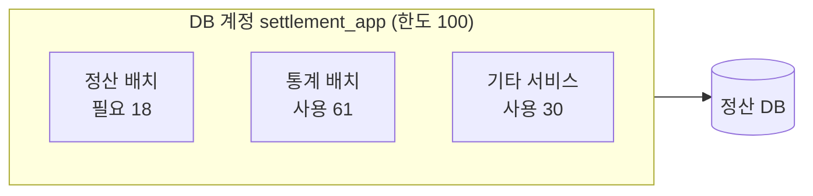

<!-- 독자: 개발 조직 전체(intermediate) + 재무시스템팀 — 정산 배치 내부를 모르는 독자도 요약과 영향만으로 상황을 알 수 있어야 함 / 어조: 합니다체 / 유형: 포스트모템 -->
<!-- 이 문서는 tech-writer 스킬의 본보기다. 소재(정산 배치, 사내 도구 이름, 수치)는 설명을 위해 만든 것이다. -->

# 2027-02-10 정산 지연으로 송금 3시간 연기

<!-- ✓ Q-3: 작성 정보와 공개 범위 -->
작성: 정산플랫폼팀 · 작성일: 2027-02-11 · 상태: 재발 방지 조치 진행 중 · 공개 범위: 사내 전체

이 문서는 사람의 실수를 따지지 않습니다. 같은 일이 다시 일어나지 않도록 시스템과 절차를 바꾸는 데 목적이 있습니다.

## 요약

<!-- ✓ E-2: 무엇이, 언제, 누구에게, 원인과 조치까지 3~4문장 -->
2027년 2월 10일 10:00에 시작한 정산 2회차가 2시간 41분 늦게 끝나, 11:00 예정이던 2회차 송금이 14:00로 연기됐습니다. 가맹점 4,812곳의 송금 19억 3,000만 원이 3시간 늦게 나갔고, 금액 오류나 누락은 없었습니다. 원인은 같은 시각에 실행된 통계 배치가 정산 DB 커넥션 한도를 나눠 쓴 것이었습니다. 통계 배치를 읽기 복제본으로 옮겨 재발을 막았습니다.

## 영향

<!-- ✓ F-2: 영향을 수치로 -->
<!-- ✓ L-4: 평시와 비교한 표 -->
| 항목 | 평시 2회차 | 이번 2회차 |
|---|---|---|
| 정산 완료 시각 | 10:04 | 12:45 |
| 송금 시각 | 11:00 | 14:00 |
| 영향받은 가맹점 | — | 4,812곳 |
| 지연된 송금액 | — | 19억 3,000만 원 |
| 정산 금액 오류 | 0건 | 0건 |

1회차(02:00)와 3회차(18:00)는 영향이 없었습니다. 가맹점 문의는 37건 들어왔고 모두 당일 안내를 마쳤습니다.

## 타임라인

<!-- ✓ E-4: 시간순, 감지·판단·조치·복구 시점이 드러나게 -->
| 시각 (KST) | 사건 |
|---|---|
| 10:00 | 정산 2회차 시작. 같은 시각 데이터분석팀 통계 배치도 시작(2월 3일 일정 변경) |
| 10:06 | 정산 배치에서 `Connection is not available` 첫 발생, 스텝 재시도 시작 |
| 10:45 | `SettlementBatchDelayed` 알림. 당번이 런북 확인 시작 |
| 10:52 | 당번이 절차 A(커넥션 부족)로 판단. 풀 크기는 정상이어서 원인을 찾지 못함 |
| 11:00 | 2회차 송금 배치가 정산 미완료로 대기. 재무시스템팀에 송금 지연 공유 |
| 11:20 | DB 계정별 커넥션 확인. `settlement_app` 계정 커넥션 98/100, 그중 61개가 통계 배치 |
| 11:34 | 데이터분석팀이 통계 배치 중단 |
| 11:41 | 정산 2회차 `--resume`으로 재실행 |
| 12:45 | 정산 2회차 완료 |
| 13:10 | 재무시스템팀이 송금 연기 결정(14:00) 공지 |
| 14:00 | 2회차 송금 완료 |

## 원인: 통계 배치와 DB 계정 공유

<!-- ✓ E-5: "범주: 결론" 형태의 H2 -->
<!-- ✓ S-1: 직접 원인과 유발 요인, 감지가 늦은 이유를 나눈다 -->
- **직접 원인**: 통계 배치가 정산 배치와 같은 DB 계정(`settlement_app`)을 써서, 계정 커넥션 한도(100)를 두 배치가 나눠 썼습니다. 커넥션 한도는 두 겹입니다. 배치 안의 풀 크기(정산 배치 18개)는 "배치가 최대 몇 개를 빌려 올지"이고, DB 계정 한도(100)는 "그 계정으로 DB 전체에 동시에 열 수 있는 수"입니다. 정산 배치의 풀 크기는 정상이었지만, 계정 한도가 먼저 차서 18개 중 일부만 받았습니다.
- **유발 요인**: 2월 3일 통계 배치 일정이 09:00에서 10:00으로 바뀌어 정산 2회차와 처음 겹쳤습니다. 일정 변경이 정산플랫폼팀에 공유되지 않았습니다.
- **감지가 늦은 이유**: 지연 알림이 시작 후 45분에 설정돼 있었고, 런북의 첫 분기가 풀 크기만 확인해 계정 한도를 보지 않았습니다(28분 소요).

<!-- ✓ M-3: 그림 앞 안내, 뒤 핵심 -->
다음 그림은 두 배치가 같은 계정 한도를 나눠 쓴 상황입니다.



세 사용처가 원한 커넥션의 합(109)이 한도(100)를 넘었습니다. 실제로 열린 커넥션은 한도 근처인 98개였고(타임라인 11:20), 가장 늦게 요청한 정산 배치가 남은 커넥션을 기다리게 됐습니다. 통계 배치는 읽기만 하므로 읽기 복제본과 전용 계정으로 옮겼고, 이제 정산 DB의 `settlement_app` 한도를 쓰지 않습니다.

## 대응

- 잘 된 점: 정산 배치가 500건 단위로 커밋해, `--resume`으로 처음부터 다시 돌리지 않고 이어서 처리했습니다. 금액 오류가 없었던 이유입니다.
- 늦어진 점: 런북 절차 A에 계정 한도 확인이 없어 원인 파악에 28분이 더 걸렸습니다.

## 재발 방지 조치

<!-- ✓ P-3: 막연한 다짐이 아니라 시스템과 절차 변경, 담당과 기한 -->
| 조치 | 담당 | 기한 | 상태 |
|---|---|---|---|
| 통계 배치를 읽기 복제본과 전용 계정으로 이전 | 데이터분석팀 | 2027-02-11 | 완료 |
| `settlement_app` 계정을 정산 배치 전용으로 제한 | 데이터플랫폼팀 | 2027-02-17 | 진행 중 |
| 계정 커넥션 80% 초과 알림 추가 | 정산플랫폼팀 | 2027-02-17 | 진행 중 |
| 지연 알림을 시작 후 45분에서 15분으로 당김 | 정산플랫폼팀 | 2027-02-12 | 완료 |
| 런북 절차 A에 계정별 커넥션 확인 추가 | 정산플랫폼팀 | 2027-02-12 | 완료 |

## 교훈

- **공유 자원은 전용으로 나눈다.** DB 계정처럼 한도가 있는 자원을 여러 팀이 쓰면, 한 팀의 일정 변경이 다른 팀 장애가 됩니다.
- **알림 시점은 복구 시간에서 거꾸로 정한다.** 송금까지 60분이 남았는데 45분에 울리는 알림은 늦습니다.
- **런북의 첫 분기는 가장 흔한 원인이 아니라 가장 빨리 배제할 수 있는 원인부터 본다.**

다른 팀에서 점검해 볼 것(PostgreSQL 기준, MySQL은 `information_schema.processlist`를 `user`, `host`로 묶어 같은 방법으로 봅니다):

1. 계정마다 연결 한도를 확인합니다.

   ```sql
   SELECT rolname, rolconnlimit FROM pg_roles WHERE rolcanlogin;
   ```

2. 계정마다 어떤 작업이 몇 개를 쓰는지 봅니다.

   ```sql
   SELECT usename, application_name, count(*) FROM pg_stat_activity GROUP BY 1, 2 ORDER BY 1, 3 DESC;
   ```

3. 한 계정을 둘 이상의 작업(`application_name`)이 쓰고, 합계가 한도의 80%를 넘는 시간대가 있으면 이번과 같은 위험이 있습니다. 데이터플랫폼팀(`#dba-help`)에 작업별 계정 분리를 요청합니다.
