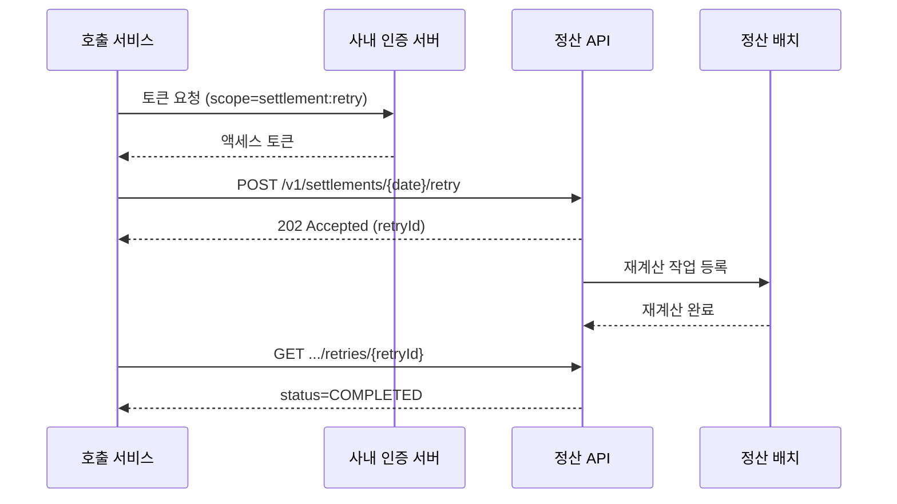

<!-- 독자: backend-dev(intermediate) — 정산 API를 호출하는 다른 팀 개발자, REST와 OAuth 2.0은 앎 / 어조: 합니다체 / 유형: 참조 -->
<!-- 이 문서는 tech-writer 스킬의 본보기다. 소재(정산 API, 사내 도구 이름, 수치)는 설명을 위해 만든 것이다. -->

# 정산 재처리 API

<!-- ✓ E-1: 무엇이고 언제 쓰는지 2문장 -->
특정 날짜의 정산을 다시 계산하도록 요청하는 API입니다. 주문 데이터를 보정한 뒤 정산 금액에 반영해야 할 때 씁니다.

## 개요

| 항목 | 값 |
|---|---|
| 메서드·경로 | `POST /v1/settlements/{date}/retry` |
| 처리 방식 | 비동기. 요청을 받으면 바로 `202`를 돌려주고, 재계산은 정산 배치가 처리합니다 |
| 처리 시간 | 주문 10만 건 기준 약 8분 |
| 같은 날짜 동시 요청 | 불가. 진행 중이면 `409`를 돌려줍니다 |

<!-- ✓ J-2: 시스템 동작 설명은 시스템을 주어로 -->
재계산이 끝나면 정산 배치가 `settlement.retried` 토픽에 완료 이벤트를 발행합니다. 완료를 기다려야 하면 Kafka 토픽 `settlement.retried`를 구독하거나, 상태 조회 API를 30초 간격으로 호출합니다. 상태 조회에도 같은 토큰(`settlement:retry`)을 씁니다.

```http
GET /v1/settlements/{date}/retries/{retryId} HTTP/1.1
```

```json
{"retryId": "rt_01J9X4K2", "status": "COMPLETED", "settledCount": 312, "failedCount": 0, "finishedAt": "2026-10-15T14:08:11+09:00"}
```

`status`는 `QUEUED`, `RUNNING`, `COMPLETED`, `FAILED` 중 하나입니다. `FAILED`면 `failedCount`만큼의 주문이 정산 DLQ(Dead Letter Queue, 처리에 실패한 메시지를 모아 두는 큐)로 갔다는 뜻이며, 정산플랫폼팀이 재처리합니다. 같은 요청을 다시 보내지 않습니다.

## 사전 정보

<!-- ✓ D-2: 모든 호출에 필요한 인증 정보를 앞에 모은다 -->
- 기본 URL: `https://settlement-api.example.internal`
- 인증: OAuth 2.0 클라이언트 자격 증명(Client Credentials). 호출 서비스용 `client_id`와 `client_secret`은 사내 개발자 포털의 "API 클라이언트 등록"에서 발급받고, 같은 화면에서 `settlement:retry` 범위(scope)를 신청합니다(정산플랫폼팀 승인, 영업일 1일). 토큰은 1시간 동안 유효합니다.
- 공통 헤더: `Authorization: Bearer <액세스 토큰>`, `Idempotency-Key: <요청마다 새로 만든 UUID>`

토큰은 다음처럼 받습니다.

```bash
curl -X POST "https://auth.example.internal/oauth2/token" \
  -d "grant_type=client_credentials&scope=settlement:retry" \
  -u "$CLIENT_ID:$CLIENT_SECRET"
```

```json
{"access_token": "eyJhbGciOi...", "token_type": "Bearer", "expires_in": 3600}
```

<!-- ✓ M-3: 그림 앞 안내, 뒤 핵심 -->
다음 그림은 토큰을 받아 재처리를 요청하고 완료를 확인하는 순서입니다.



<!-- ✓ C-5: 독자가 모를 수 있는 멱등 키를 한 문장으로 정의 -->
`Idempotency-Key`(멱등 키)는 같은 요청이 네트워크 문제로 두 번 들어와도 한 번만 처리하게 하는 값입니다. 정산 API는 같은 키를 24시간 동안 기억하고, 같은 키로 다시 보내면 처음 요청의 `202` 응답을 그대로 돌려줍니다. 응답을 받지 못해 다시 보낼 때는 같은 키를 씁니다.

## 시그니처

```http
POST /v1/settlements/{date}/retry HTTP/1.1
Host: settlement-api.example.internal
Authorization: Bearer <액세스 토큰>
Idempotency-Key: <UUID>
Content-Type: application/json
```

## 매개변수

<!-- ✓ L-4: 이름 | 타입 | 필수 | 기본값 | 설명 열 순서 통일 -->
| 이름 | 위치 | 타입 | 필수 | 기본값 | 설명 |
|---|---|---|---|---|---|
| `date` | 경로 | string (`YYYY-MM-DD`) | 예 | — | 재계산할 정산 날짜. 오늘 이후 날짜는 받지 않습니다 |
| `merchantIds` | 본문 | string[] | 아니요 | 전체 가맹점 | 특정 가맹점만 재계산할 때 지정합니다. 최대 500개 |
| `reason` | 본문 | string | 예 | — | 재처리 사유. 감사 로그에 남습니다. 10~200자 |

## 반환값

`202 Accepted`

| 필드 | 타입 | 설명 |
|---|---|---|
| `retryId` | string | 재처리 작업 ID. 상태 조회와 문의에 씁니다 |
| `date` | string | 요청한 정산 날짜 |
| `status` | string | 항상 `QUEUED` |
| `targetCount` | integer | 재계산 대상 주문 수 |

## 오류

<!-- ✓ P-3: 오류마다 의미와 대처를 함께(조치 칼럼 필수) -->
| 상태 코드 | 오류 코드 | 의미 | 대처 |
|---|---|---|---|
| 400 | `INVALID_DATE` | 날짜 형식이 틀렸거나 오늘 이후 날짜 | `YYYY-MM-DD` 형식의 오늘 이전 날짜로 다시 요청합니다 |
| 401 | `INVALID_TOKEN` | 토큰이 없거나 만료됨 | 토큰을 다시 발급받아 요청합니다 |
| 403 | `INSUFFICIENT_SCOPE` | 토큰에 `settlement:retry` 범위가 없음 | 개발자 포털 "API 클라이언트 등록"에서 범위를 신청하고, 승인 뒤 토큰을 새로 받습니다 |
| 404 | `SETTLEMENT_NOT_FOUND` | 그 날짜에 정산 결과가 아직 없음 | 정산 배치(매일 02:00 KST 시작, 02:30께 완료)가 끝난 뒤 다시 요청합니다 |
| 409 | `SETTLEMENT_IN_PROGRESS` | 같은 날짜의 재처리가 진행 중 | 응답의 `retryId`로 상태를 조회하고, `COMPLETED`가 된 뒤 요청합니다 |
| 429 | `TOO_MANY_REQUESTS` | 호출 서비스별 분당 10회 초과 | `Retry-After` 헤더의 초만큼 기다린 뒤 같은 멱등 키로 다시 보냅니다 |
| 503 | `SETTLEMENT_UNAVAILABLE` | 정산 배치 점검 중 | 1분 간격으로 최대 5번 다시 보냅니다. 계속 실패하면 `#settlement-help`에 문의합니다 |

## 예제

<!-- ✓ N-1: 요청과 응답을 함께 -->
2026년 10월 14일 정산 중 가맹점 두 곳만 재계산합니다.

```bash
curl -X POST "https://settlement-api.example.internal/v1/settlements/2026-10-14/retry" \
  -H "Authorization: Bearer $TOKEN" \
  -H "Idempotency-Key: $(uuidgen)" \
  -H "Content-Type: application/json" \
  -d '{"merchantIds": ["M-1042", "M-2210"], "reason": "주문 금액 보정(CS-8812) 반영"}'
```

```json
{
  "retryId": "rt_01J9X4K2",
  "date": "2026-10-14",
  "status": "QUEUED",
  "targetCount": 312
}
```

<!-- ✓ N-4: 대표 오류 응답도 보여 준다 -->
같은 날짜의 재처리가 이미 진행 중이면 다음 응답을 받습니다.

```json
{
  "code": "SETTLEMENT_IN_PROGRESS",
  "message": "2026-10-14 정산 재처리가 진행 중입니다.",
  "retryId": "rt_01J9X3ZQ"
}
```
