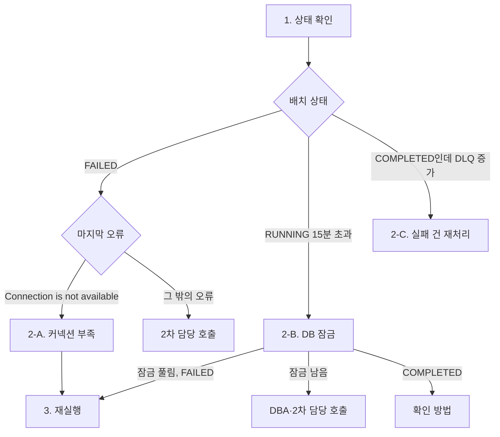

<!-- 독자: on-call 개발자(intermediate) — 장애 알림을 받고 새벽에 읽는 정산플랫폼팀 당번, kubectl과 Grafana는 익숙함 / 어조: 합니다체 / 유형: 문제 해결(런북) -->
<!-- 이 문서는 tech-writer 스킬의 본보기다. 소재(정산 배치, 사내 도구 이름, 수치)는 설명을 위해 만든 것이다. 하루 3회차 정산(design-adr.md) 이후 기준이다. -->

# 정산 배치 장애 대응 런북

<!-- ✓ C-3: 장애 중에 읽힌다고 보고 원리는 링크로 빼고 행동만 남긴다 -->
정산 배치가 제시간에 끝나지 않을 때 송금 전에 정산을 마치기 위한 절차입니다. 원리는 "정산 배치는 어떻게 동작하나"를 봅니다.

## 개요

<!-- ✓ E-1: 다루는 범위, 소요 시간, 기한 -->
정산 배치가 실패하거나 지연될 때 원인을 세 갈래로 가르고 복구합니다. 회차 정산은 평소 3분이면 끝나고, 지연 알림은 시작 15분 뒤에 오므로 알림부터 복구 기한까지 15분이 있습니다. 이 런북의 절차는 대부분 10분 안에 끝납니다.

<!-- ✓ F-2: 기한을 회차별 시각으로 -->
| 회차 | 정산 시작 | 송금 시작 | 복구 기한 (송금 30분 전) |
|---|---|---|---|
| 1회차 | 02:00 | 03:00 | 02:30 |
| 2회차 | 10:00 | 11:00 | 10:30 |
| 3회차 | 18:00 | 19:00 | 18:30 |

모든 시각은 KST입니다. 복구 기한까지 끝내지 못하면 "연락처"의 재무시스템팀 당번에게 송금 연기를 요청합니다.

## 언제 쓰는가

다음 알림 중 하나가 `#settlement-alert`에 오면 이 런북을 엽니다.

| 알림 | 조건 |
|---|---|
| `SettlementBatchFailed` | 정산 배치 상태가 `FAILED` |
| `SettlementBatchDelayed` | 시작 후 15분이 지나도 `COMPLETED`가 아님 |
| `SettlementDlqGrowing` | DLQ(Dead Letter Queue, 처리에 실패한 메시지를 모아 두는 큐) 적체가 10분 동안 500건 넘게 늘어남 |

## 사전 확인

- [ ] `settlement-operator` 역할로 운영 클러스터에 접속됩니다: `kubectl auth can-i create jobs -n settlement`가 `yes`
- [ ] Grafana "정산 배치 현황" 대시보드가 열립니다
- [ ] `#settlement-incident` 채널에 아래 발생 공지를 올렸습니다

권한 확인이 `no`면 복구를 직접 하지 말고 2차 담당(정산플랫폼팀 리드)에게 전화해 대신 실행을 요청합니다.

<!-- ✓ N-1: 복사해 쓰는 메시지 템플릿 -->
```text
[정산 배치 장애 대응 시작] <날짜> <회차>회차
- 알림: <알림 이름>
- 담당: @<이름>
- 송금 영향 여부: 확인 중 (복구 기한 <개요 표의 시각>)
```

## 절차

<!-- ✓ M-1: 분기가 셋 이상이라 판단 흐름을 그림으로 -->
<!-- ✓ M-3: 그림 앞 안내 -->
다음 그림은 1단계에서 상태를 보고 2단계의 어느 조치로 갈지 정하는 흐름입니다.



3단계 재실행으로 모이는 길은 2-A와 잠금은 풀렸지만 `FAILED`인 2-B뿐입니다. 2-C는 재실행 없이 확인으로 갑니다.

<!-- ✓ L-2: 한 단계 한 동작, 분기는 하위 조치로 나눠 번호로 다시 합류 -->
### 1. 상태와 마지막 오류를 확인합니다

```bash
settlement-cli status --env prod --date <날짜> --round <회차>
```

| 결과 | 갈 곳 |
|---|---|
| `FAILED`, 오류에 `Connection is not available` | 2-A |
| `RUNNING`, 시작 후 15분 초과 | 2-B |
| `COMPLETED`, DLQ 증가 | 2-C (3단계는 하지 않음) |
| 그 밖 | "연락처"의 2차 담당에게 전화 |

### 2-A. 커넥션 부족을 해결합니다

1. 풀 크기를 확인합니다. `maximum-pool-size`가 `concurrency + 2`보다 작으면 "정산 배치 커넥션 타임아웃 해결하기"의 원인 1을 따릅니다.

   ```bash
   kubectl get configmap settlement-batch -n settlement -o yaml | grep -E "concurrency|maximum-pool-size"
   ```

2. 풀 크기가 정상이면 DB 계정 커넥션을 확인합니다. 아래 쿼리의 마지막 줄(`합계`)이 90을 넘고 `settlement-batch`가 아닌 `application_name`이 섞여 있으면, 그 서비스 담당 팀에 중단을 요청합니다(2027-02-10 장애 원인).

   ```sql
   SELECT coalesce(application_name, '합계') AS app, count(*)
   FROM pg_stat_activity WHERE usename = 'settlement_app'
   GROUP BY ROLLUP(application_name) ORDER BY 2;
   ```

3. 3단계로 갑니다.

### 2-B. DB 잠금을 풉니다

1. 잠금을 잡고 있는 세션을 찾습니다.

   ```sql
   SELECT pid, application_name, now() - xact_start AS duration, left(query, 80)
   FROM pg_stat_activity
   WHERE datname = 'settlement' AND state = 'active'
   ORDER BY duration DESC LIMIT 5;
   ```

<!-- ✓ P-2: 되돌릴 수 없는 단계 바로 앞에 경고 -->
> [!WARNING]
> 다음 명령은 실행 중인 트랜잭션을 롤백합니다. `application_name`이 `settlement-batch`인 세션만 끊습니다. `payout-batch`(재무시스템팀 송금 배치)의 세션이면 끊지 말고 2차 담당을 호출합니다.

2. 잠금을 잡은 세션을 끊습니다.

   ```sql
   SELECT pg_terminate_backend(<pid>);
   ```

3. 5분 동안 상태를 봅니다.
   - 배치가 스스로 이어서 `COMPLETED`가 되면 "확인 방법"으로 갑니다.
   - 1번 쿼리에 같은 세션이 아직 있으면(잠금이 풀리지 않음) 재실행하지 말고 데이터플랫폼팀(`#dba-help`)과 2차 담당을 함께 호출합니다.
   - 잠금은 풀렸는데 배치가 `FAILED`면 3단계로 갑니다.

### 2-C. 실패 건을 재처리합니다

"정산 배치 실패 건 재처리하기"를 따른 뒤 "확인 방법"으로 갑니다.

### 3. 배치를 다시 실행합니다

<!-- ✓ J-1: 독자가 주체인 능동형 지시 -->
실패한 회차를 이어서 실행합니다. 정산 배치는 500건 단위로 커밋하므로, 이미 저장된 부분은 건너뜁니다.

```bash
settlement-cli run --env prod --date <날짜> --round <회차> --resume
```

재실행은 한 번만 합니다. 재실행이 다시 `FAILED`가 되거나 복구 기한까지 `COMPLETED`가 되지 않으면 더 시도하지 말고 2차 담당과 재무시스템팀 당번을 동시에 호출해 송금 연기를 요청합니다. 송금 연기는 결정에 5분쯤 걸리므로, 재실행 뒤 5분이 지나도 `RUNNING`이면 미리 재무시스템팀 당번에게 상황을 알립니다.

## 롤백

재실행 결과가 이상하면(회차 합계가 전날 같은 회차의 50% 미만이거나 200% 초과) 그 회차 정산을 되돌리고 송금을 막습니다.

```bash
settlement-cli rollback --env prod --date <날짜> --round <회차>
settlement-cli payout hold --env prod --date <날짜> --round <회차>
```

마감(`CLOSED`)된 회차는 롤백할 수 없습니다. 이때는 "정산 재처리 API"로만 고칩니다.

## 확인 방법

<!-- ✓ N-2: 정상 복귀 판단 기준을 수치로 -->
세 가지가 모두 맞으면 복구된 것입니다.

1. `settlement-cli status`가 `COMPLETED`
2. DLQ 적체가 0
3. 회차 합계가 전날 같은 회차의 70~130% 범위

확인되면 `#settlement-incident`에 종료 공지를 올립니다.

```text
[정산 배치 장애 대응 종료] <날짜> <회차>회차
- 원인: <한 줄>
- 조치: <한 줄>
- 송금 영향: 없음 / <영향>
- 포스트모템 필요: 예 / 아니요
```

## 연락처

| 역할 | 대상 | 연락 방법 |
|---|---|---|
| 1차 | 정산플랫폼팀 당번 | `#settlement-alert` 호출 |
| 2차 | 정산플랫폼팀 리드 | 당번표의 전화번호 |
| 송금 연기 결정 | 재무시스템팀 당번 | `#finance-oncall` |
| DB | 데이터플랫폼팀 | `#dba-help` |
