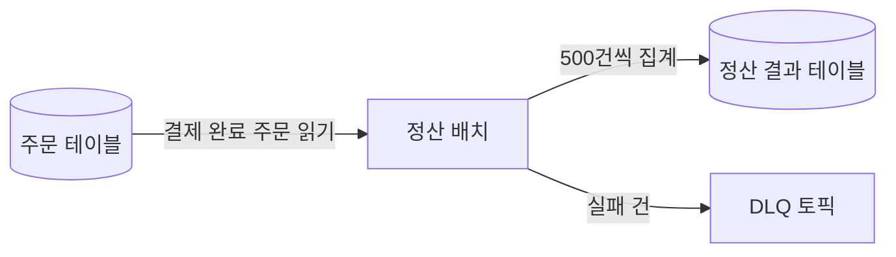

<!-- 독자: backend-dev(beginner) — 정산플랫폼팀 신규 입사자, Spring Boot는 알지만 정산 도메인과 사내 인프라는 처음 / 어조: 합니다체 / 유형: 학습(튜토리얼) -->
<!-- 이 문서는 tech-writer 스킬의 본보기다. 소재(정산 배치, 사내 도구 이름, 수치)는 설명을 위해 만든 것이다. 하루 1회 정산 시절(design-adr.md 이전) 기준이다. -->

# 로컬에서 정산 배치 처음 실행하기

<!-- ✓ E-1: 개요 2문장. 끝나면 무엇을 할 수 있는지와 소요 시간 -->
로컬 환경에서 정산 배치를 실행해 하루치 주문을 정산하고, 결과를 정산 DB에서 확인합니다. 30분 정도 걸리며, 끝나면 배치 코드를 고친 뒤 직접 돌려 볼 수 있습니다.

<!-- ✓ E-2: 단계 지도를 먼저 보여 줘 끝까지의 경로를 첫 화면에 둔다 -->
전체 흐름은 네 단계입니다.

1. 로컬 인프라(PostgreSQL, Kafka)를 띄웁니다.
2. 테스트 주문 데이터를 넣습니다.
3. 정산 배치를 실행합니다.
4. 정산 결과를 확인합니다.

## 목표

이 튜토리얼을 마치면 다음을 할 수 있습니다.

- 정산 배치를 로컬에서 날짜를 지정해 실행합니다.
- 배치가 만든 정산 결과를 SQL로 조회합니다.
- 배치 로그에서 처리 건수와 실패 건수를 읽습니다.

## 사전 준비

<!-- ✓ C-5: 독자 knows에 없는 사내 도구(settlement-cli)는 설치 경로까지 적는다 -->
| 준비물 | 버전 | 확인 명령 |
|---|---|---|
| JDK(Java Development Kit) | 21 | `java -version` |
| Docker Desktop | 4.30 이상 | `docker compose version` |
| settlement-cli (사내 배치 실행 도구) | 2.3 이상 | `settlement-cli --version` |

settlement-cli가 없으면 사내 개발자 포털의 "개발 도구 설치" 문서를 따라 설치합니다.

정산 배치 저장소를 받아 둡니다.

```bash
git clone git@git.example.internal:settlement/settlement-batch.git
cd settlement-batch
```

## 1단계: 로컬 인프라 띄우기

<!-- ✓ L-5: 코드 앞에 무엇을 하는지 한 문장 -->
정산 배치가 읽고 쓰는 PostgreSQL과 Kafka를 Docker로 띄웁니다.

```bash
docker compose -f local/docker-compose.yml up -d
```

<!-- ✓ N-2: 단계마다 성공 판정 기준 -->
두 컨테이너의 `STATUS`가 `healthy`면 다음 단계로 갑니다.

```bash
docker compose -f local/docker-compose.yml ps
```

```text
NAME                 STATUS
settlement-db        Up 20 seconds (healthy)
settlement-kafka     Up 20 seconds (healthy)
```

## 2단계: 테스트 주문 넣기

<!-- ✓ C-5: 처음 나오는 도메인 개념(결제 완료 주문)을 한 문장으로 정의 -->
정산 배치는 결제가 끝난 주문(결제 완료 주문)만 정산합니다. 2026년 10월 14일자 결제 완료 주문 1,000건을 넣습니다.

```bash
./gradlew :tools:seed --args="--date=2026-10-14 --count=1000"
```

마지막 줄에 `seeded 1000 paid orders`가 보이면 성공입니다.

## 3단계: 정산 배치 실행하기

<!-- ✓ F-6: 2단계에서 정한 날짜를 여기서 다시 쓴다는 것을 밝힌다 -->
2단계에서 주문을 넣은 날짜(2026-10-14)를 지정해 배치를 실행합니다.

```bash
settlement-cli run --profile local --date 2026-10-14
```

`--profile local`은 1단계에서 띄운 로컬 PostgreSQL과 Kafka에 접속하는 설정(`src/main/resources/application-local.yml`)을 씁니다. 배치는 다음 순서로 주문을 처리합니다.

<!-- ✓ M-3: 그림 앞 안내 문장, 뒤 핵심 문장 -->


정산에 실패한 주문은 결과 테이블이 아니라 DLQ(Dead Letter Queue, 실패 메시지를 모아 두는 Kafka 토픽)로 갑니다.

<!-- ✓ N-1: 실행 결과를 함께 보여 줘 독자가 자기 결과와 비교하게 한다 -->
실행이 끝나면 로그 마지막에 처리 요약이 나옵니다.

```text
[settlement] date=2026-10-14 read=1000 settled=1000 failed=0 elapsed=4.2s
```

`failed`가 0이 아니면 "문제가 생기면" 절을 봅니다.

## 4단계: 결과 확인하기

정산 결과는 가맹점별로 하루 한 행씩 저장됩니다. 로컬 DB에 접속해 조회합니다. 로컬 DB는 비밀번호를 묻지 않으며, 조회가 끝나면 `\q`로 나옵니다.

```bash
docker exec -it settlement-db psql -U settlement -d settlement
```

```sql
SELECT merchant_id, order_count, settled_amount
FROM daily_settlement
WHERE settlement_date = '2026-10-14'
ORDER BY settled_amount DESC
LIMIT 3;
```

테스트 데이터는 매번 같은 값으로 만들어지므로 결과도 같습니다.

```text
 merchant_id | order_count | settled_amount
-------------+-------------+----------------
 M-0007      |          41 |        2318400
 M-0013      |          38 |        2104750
 M-0002      |          35 |        1987300
```

## 결과 확인

4단계에서 psql을 나왔다면 같은 명령으로 다시 접속한 뒤 확인합니다. 다음 두 가지가 맞으면 튜토리얼을 마친 것입니다.

- 3단계 로그의 `settled=1000`
- 아래 쿼리 결과가 `1000`

```sql
SELECT sum(order_count) FROM daily_settlement WHERE settlement_date = '2026-10-14';
```

결과가 1000보다 작으면 3단계 로그의 `failed` 값만큼 비어 있는지 봅니다. 같으면 정산 실패 건이고("문제가 생기면" 참고), 다르면 2단계를 다시 실행한 뒤 3단계부터 반복합니다.

실습이 끝나면 로컬 인프라를 내립니다. 같은 날짜로 배치를 다시 실행해도 결과는 덮어써지므로 안전합니다.

```bash
docker compose -f local/docker-compose.yml down
```

<details>
<summary>문제가 생기면</summary>

<!-- ✓ L-9: 주된 흐름에 필요 없는 실패 대처는 접어 둔다 -->
| 증상 | 확인할 것 |
|---|---|
| 1단계에서 `settlement-db`가 `unhealthy` | 로컬 5432 포트를 다른 PostgreSQL이 쓰고 있는지 `lsof -i :5432`로 확인합니다 |
| 3단계 로그의 `read=0` | 2단계의 `--date`와 3단계의 `--date`가 같은지 확인합니다 |
| 3단계 로그의 `failed`가 0보다 큼 | "정산 배치 실패 건 재처리하기" 문서를 봅니다 |

</details>

## 다음 단계

<!-- ✓ T-3: 이어서 읽을 문서를 유형별로 안내 -->
- 정산 금액이 어떻게 계산되는지 알고 싶다면: "정산 배치는 어떻게 동작하나"(설명)
- 실패한 정산을 다시 돌리려면: "정산 배치 실패 건 재처리하기"(how-to)
- 배치 설정 값을 찾으려면: "정산 API 참조"(참조)
