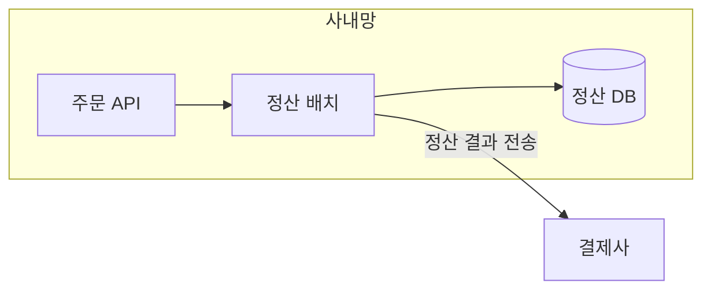

# 시각화

초안에서 구조·흐름·관계·상태를 설명하는 부분을 찾아 그림으로 보일지 정할 때 이 파일을 읽는다. 무엇을 그릴지 정한 다음, 출력 형식에 맞는 도구를 고른다.

## M-1 구조, 흐름, 관계, 상태는 그림으로 보인다

다음을 글로만 설명하고 있으면 다이어그램을 넣는다.

- 컴포넌트가 어떻게 연결되는가 (구조)
- 요청이나 데이터가 어떤 순서로 지나가는가 (흐름)
- 누가 누구를 호출하는가 (상호작용)
- 상태가 어떻게 바뀌는가 (상태 전이)

설명 문서와 설계 문서에서는 다이어그램이 거의 필수다.

왜: 관계와 순서는 글로 쓰면 독자가 머릿속에서 그림을 다시 그려야 한다. 그림은 그 수고를 덜고 더 오래 기억된다. [S5, S3, S11, S7]

## M-2 비교와 속성은 그림이 아니라 표로 보인다

항목을 같은 기준으로 비교하거나 속성을 나열하는 내용은 표로 쓴다. 관계가 없는 상자를 늘어놓은 다이어그램은 표보다 못하다.

왜: 다이어그램은 연결을 보여 줄 때 가치가 있다. 연결이 없으면 공간만 차지한다. [S1, S11]

## M-3 그림 앞뒤에 안내 문장과 핵심 문장을 둔다

다이어그램 바로 앞에 "다음 그림은 ~을 보여 준다"는 한 문장을, 바로 뒤에 독자가 그림에서 가져가야 할 핵심 한 문장을 쓴다. 그림에 있는 내용을 글로 하나하나 다시 늘어놓지 않는다.

왜: 앞 문장이 없으면 독자는 그림이 왜 여기 있는지 모르고, 뒤 문장이 없으면 무엇을 봐야 하는지 모른다. 글로 반복하면 둘 중 하나가 낭비다. [S3]

## M-4 그림 하나에는 주된 경로 하나

다이어그램 하나에 주요 노드는 12개 이하로 둔다. 주된 흐름 하나가 한눈에 보이게 하고, 곁가지는 짧게 둔다. 라벨은 짧은 명사구로 쓴다. 12개를 넘으면 개요도 하나와 세부도 여러 개로 나누거나, archify로 그린다.

왜: 모든 것을 한 그림에 넣으면 아무것도 보이지 않는다. (출처에 없는 운영 기준. archify의 주요 노드 상한과 맞춤)

## M-5 스크린숏은 환경과 크기를 맞춘다

화면 캡처를 넣을 때는 운영체제, 브라우저, 테마, 크기를 문서 안에서 통일한다. 개인 정보와 토큰은 가린다. 캡처 대신 텍스트(명령 출력, 설정 값)로 보일 수 있으면 텍스트를 쓴다.

왜: 환경이 섞인 캡처는 독자가 자기 화면과 비교하기 어렵게 한다. 텍스트는 검색되고 복사된다. [S1]

---

## 내용 → 다이어그램 종류

| 보여 줄 내용 | mermaid | archify type |
|---|---|---|
| 컴포넌트, 경계, 배포 구조 | `flowchart LR` + `subgraph` | `architecture` |
| 시간 순서의 호출·메시지 | `sequenceDiagram` | `sequence` |
| 처리 단계, 분기, 승인 흐름 | `flowchart TD` | `workflow` |
| 데이터 파이프라인, 계보 | `flowchart LR` | `dataflow` |
| 상태 전이, 재시도 | `stateDiagram-v2` | `lifecycle` |
| 데이터 모델 | `erDiagram`, `classDiagram` | — |
| 장애 타임라인 | 표가 기본. 필요하면 `timeline` | — |
| 비교, 속성 | 표 (M-2) | — |

## 출력 형식 × 복잡도 → 도구

복잡의 기준: 주요 노드가 12개를 넘거나, 시스템 경계·보안 영역·브랜드 아이콘이 필요한 경우.

| config `output.format` | 단순 | 복잡 |
|---|---|---|
| markdown | mermaid 코드 블록 | mermaid 개요도 + archify HTML을 `assets_dir`에 두고 링크 |
| confluence | `render-mermaid.sh`로 SVG/PNG를 만들어 첨부 (매크로가 있으면 코드) | mermaid 개요도 이미지 + archify HTML 첨부 또는 링크 |
| html | `render-mermaid.sh`로 만든 SVG를 인라인으로 삽입 | archify HTML을 넣거나 링크 |

config `output.diagrams`가 `mermaid`면 archify를 쓰지 않고, `archify`면 복잡하지 않아도 archify를 우선하며, `none`이면 다이어그램 대신 표와 목록으로 쓴다.

archify는 이미지를 CLI로 내보내지 않는다. Markdown·Confluence 본문에 넣을 정적 이미지는 언제나 mermaid로 만든다.

## mermaid 작성 규칙

- 노드 ID는 영문, 라벨은 한국어로 쓰고 따옴표로 감싼다. 예) `batch["정산 배치"]`
- 방향은 흐름이면 `LR`, 위계·절차면 `TD`.
- 경계는 `subgraph`로 묶고 이름을 붙인다.
- 화살표 라벨은 동사구 짧게. 예) `api -->|"주문 조회"| db`
- 색과 스타일은 넣지 않는다. 강조가 꼭 필요하면 노드 하나만.



## 렌더링 절차

1. 코드 블록 내용을 `<assets_dir>/<문서명>-<번호>.mmd`로 저장한다.
2. 실행한다.

   ```bash
   bash <스킬 디렉터리>/scripts/render-mermaid.sh <assets_dir>/<이름>.mmd <assets_dir>/<이름>.svg
   ```

3. 종료 코드가 1이면 stderr의 오류 줄을 보고 문법을 고친 뒤 다시 실행한다.
4. 두 번 고쳐도 실패하면 Markdown에서는 코드 블록을 그대로 두고, Confluence·HTML에서는 다이어그램 자리에 코드 블록을 넣은 뒤 결과 보고에 실패를 적는다. 다이어그램을 조용히 빼지 않는다.
5. Markdown 출력에서도 렌더링을 한 번 실행해 문법 오류가 없는지 확인한다(이미지는 커밋하지 않아도 된다).

## archify 호출 절차

1. archify 스킬을 부르고, 위 표에서 type을 고른다.
2. 다이어그램이 문서의 사실과 맞아야 하므로 노드·관계는 재료(코드, 설정, 사용자 설명)에서 확인한 것만 넣는다.
3. 산출 HTML은 `<assets_dir>/<문서명>-architecture.html`에 둔다.
4. 문서 본문에는 mermaid 개요도를 넣고, 바로 아래에 "자세한 구조: archify 다이어그램 링크"를 둔다.
5. archify가 설치돼 있지 않으면 mermaid로 개요도와 세부도를 나눠 그린다.
